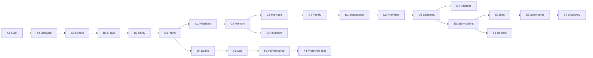

# KingGame — Development Roadmap

Dependency-aware implementation milestones. Each milestone is independently reviewable and mergeable.

**Design docs:** [GAME_DESIGN.md](./GAME_DESIGN.md) · [SIMULATION_ARCHITECTURE.md](./SIMULATION_ARCHITECTURE.md) · [CURRENT_STATE_AUDIT.md](./CURRENT_STATE_AUDIT.md) · [SIMULATION_EVALUATION.md](./SIMULATION_EVALUATION.md) · [DECISIONS.md](./DECISIONS.md)

---

## Effort scale

| Label | Meaning |
|-------|---------|
| **S** | Small: 1–3 focused PRs, mostly one module |
| **M** | Medium: multiple modules, new tests |
| **L** | Large: cross-cutting, new subsystems |

---

## Milestone overview

| ID | Name | Effort | Depends on | Parallel? |
|----|------|--------|------------|-----------|
| A1 | Audit & invariants doc | S | — | — |
| A2 | Lifecycle integrity | S | A1 | — |
| A3 | Event semantics & causality | M | A2 | — |
| B1 | Goals & motivations | M | A3 | — |
| B2 | Utility scoring | M | B1 | — |
| B3 | Plans & resolver v1 | L | B2 | — |
| B4 | Agency evaluation harness | M | B3 | with C1 early |
| C1 | Relationship dynamics | M | B3 | — |
| C2 | Memories & emotions | M | C1 | — |
| C3 | Motivated marriage | M | C2 | — |
| C4 | Family obligations | M | C3 | — |
| C5 | Rumours & beliefs | L | C2 | after C3 preferred |
| D1 | Succession & claims | M | C4 | — |
| D2 | Promises & alliances | M | D1, C1 | — |
| D3 | Schemes & reconciliation | L | D2 | — |
| D4 | Factions & disputes | L | D3 | — |
| E1 | Causal story chains | M | A3, D3 | — |
| E2 | Biographies | S | E1 | — |
| E3 | Historical summaries | M | E1 | — |
| E4 | Story discovery tools | M | E3 | — |
| F1 | Observer investigation UI | L | E1 | partial parallel E |
| F2 | Simulation laboratory CLI | M | B4 | — |
| F3 | Performance & quality gate | M | F2, E3 | — |
| F4 | End-to-end prototype | M | F1, F3 | — |

**Minimum Story Realm (compelling prototype):** through **C4 + E1 + F1** (core observer trace). Politics **D1–D3** strongly recommended; **D4+** optional for v0.1.

---

## First implementation recommendation

**Implement next: A2 → A3 → B1** (in order).

**Why:** Prototype branch has lifecycle but weak event causality and zero agency. Fixing event semantics (A3) prevents rework when motives attach to events. B1 unlocks the core vision (Pillar A). Do **not** start B2 until goals exist.

**A1** is satisfied by this documentation pass.

---

## Stage A — Foundations

### A1 — Audit, architecture, simulation invariants

1. **Purpose:** Shared truth on what exists and target architecture.
2. **Player-facing:** None (team-facing).
3. **Prerequisites:** None.
4. **Current state:** Prototype branch; main empty.
5. **Scope:** Audit doc, architecture doc, decision log, roadmap, evaluation plan.
6. **Out of scope:** Code changes to simulation behaviour.
7. **Data model changes:** None.
8. **Systems affected:** Documentation only.
9. **Tasks:** Repository audit; run pytest; publish `docs/design/*`.
10. **Examples:** N/A
11. **Testing:** Document pytest results in audit.
12. **Acceptance:** All six design docs consistent; audit categories verified against code.
13. **Risks:** Branch/main drift — audit notes both.
14. **Evidence:** Merged docs; audit lists test run.
**Effort:** S · **Status:** Complete (this pass)

---

### A2 — Character lifecycle, data integrity, persistence

1. **Purpose:** Trustworthy demography and genealogical invariants across long runs.
2. **Player-facing:** Stable family trees; saves load correctly after many years.
3. **Prerequisites:** A1.
4. **Current state:** Lifecycle in `simulation/lifecycle.py`; SQLite JSON snapshot.
5. **Scope:** Kinship validators; spouse symmetry; dead character rules; house head consistency; save/load round-trip test; optional schema `version` field.
6. **Out of scope:** New social actions; AI.
7. **Data model:** `WorldState.schema_version: int`; `Character.death_day: int | None`.
8. **Systems:** `models`, `simulation/lifecycle`, `persistence`, `tests`.
9. **Tasks:** (1) Invariant checker function `validate_world(world) -> list[Violation]`. (2) Fix marriage/spouse bidirectional bugs if any. (3) On death, clear spouse link or mark widowed. (4) Persist test save/load cycle. (5) 100-year integration test with zero invariant violations.
10. **Examples:** Head dies → exactly one new head or explicit regency gap logged.
11. **Testing:** Unit tests per invariant; integration 100y.
12. **Acceptance:** `validate_world` passes after 100y run seed=123; SQLite round-trip identical event count.
13. **Risks:** Over-strict rules block valid edge cases — allow documented exogenous events.
14. **Evidence:** CI green; report in PR.
**Effort:** S

---

### A3 — Event semantics, deterministic execution, causal tracing

1. **Purpose:** Authoritative event log suitable for investigation and story detection.
2. **Player-facing:** Foundation for “why did this happen?” (dev trace first).
3. **Prerequisites:** A2.
4. **Current state:** `WorldEvent.causes` mixed semantics; no graph index.
5. **Scope:** Normalise `causes` to event IDs; add `preconditions`, `outcome_status`; build `CausalIndex` from log; document RNG derivations; expose `trace_back(event_id)`.
6. **Out of scope:** UI trace widget (F1); significance ranking (E1).
7. **Data model:** Extend `WorldEvent`; optional `Observation` stub fields.
8. **Systems:** `history/`, `models/events.py`, `simulation/engine.py`.
9. **Tasks:** (1) Migration helper for old saves. (2) Update succession/death to link cause events. (3) Implement causal index rebuild from log. (4) API `get_causes(event_id, depth)`. (5) Determinism test extended 1000 days.
10. **Examples:** Death event causes link to prior illness/scheme event once those exist; for now link to prior life events where applicable.
11. **Testing:** Graph integrity; no dangling cause ids; determinism test.
12. **Acceptance:** 100% of post-milestone events have valid cause ids or `exogenous: true`.
13. **Risks:** Breaking save compatibility — bump schema version.
14. **Evidence:** Unit tests + sample trace output in PR.
**Effort:** M

---

## Stage B — Character agency

### B1 — Goals and motivations

1. **Purpose:** Characters want things that conflict.
2. **Player-facing:** Inspect active goals on character profile.
3. **Prerequisites:** A3.
4. **Current state:** Empty `Goal` list always.
5. **Scope:** Goal types enum; acquisition on life events (inheritance, insult, marriage); priority refresh weekly; goal conflict pairs; store on character.
6. **Out of scope:** Utility selection (B2).
7. **Data model:** `GoalKind`, `Goal.deadline`, `Goal.source_event_id`.
8. **Systems:** `character_ai/goals.py`, hook in engine after lifecycle.
9. **Tasks:** Define catalog (~15 goal kinds). Implement `refresh_goals(character, world)`. Emit goal-change debug events. Streamlit list goals.
10. **Examples:** Eleanor gains `claim_title` on father death if younger than brother.
11. **Testing:** Fixture-driven goal appearance; no duplicate exclusive goals.
12. **Acceptance:** After 10y run, ≥80% nobles have ≥1 active goal.
13. **Risks:** Goal explosion — cap active goals at 5.
14. **Evidence:** Tests + screenshot of goals in UI.
**Effort:** M

---

### B2 — Personality-driven utility scoring

1. **Purpose:** Traits bias action preferences measurably.
2. **Player-facing:** “Why this action?” shows utility breakdown (dev panel).
3. **Prerequisites:** B1, trait consolidation per DECISIONS D4.
4. **Current state:** Traits only affect marriage acceptance.
5. **Scope:** 8 dimensions; map old saves; score stub actions; softmax selection; ε noise.
6. **Out of scope:** Multi-step plans (B3).
7. **Data model:** Trait migration map; `ActionKind` enum stub.
8. **Systems:** `character_ai/utility.py`, `character_ai/traits.py`.
9. **Tasks:** Implement scoring function; softmax; log `motive_snapshot` on events; unit tests for trait ordering.
10. **Examples:** Impulsive character higher probability of `public_insult` vs cautious.
11. **Testing:** Personality sensitivity fixture (see evaluation doc).
12. **Acceptance:** Measurable action distribution divergence between trait extremes.
13. **Risks:** Caricature — temperature floor.
14. **Evidence:** B4 mini-report attached.
**Effort:** M

---

### B3 — Action resolution and short-term planning

1. **Purpose:** Characters execute multi-step intentions; world validates outcomes.
2. **Player-facing:** Chronicle shows proposals/refusals; plans visible on profile.
3. **Prerequisites:** B2.
4. **Current state:** `events/` stub; lifecycle bypasses agency.
5. **Scope:** `ActionProposal` pipeline; resolver validates preconditions; conflict rules; plans (3–5 steps) for marriage and scheme stubs; integrate staggered decision cohort in engine.
6. **Out of scope:** Full scheme catalog (D3).
7. **Data model:** `Plan`, `PlanStep`; extend events with `proposal|attempt|outcome`.
8. **Systems:** `events/resolver.py`, `character_ai/plans.py`, engine tick order update.
9. **Tasks:** Resolver queue; replace direct `process_marriages` with character proposals where possible; failure events logged.
10. **Examples:** Plan: find ally → propose marriage → if refused, spread rumour (rumour stub until C5).
11. **Testing:** Integration proposal→outcome; conflict two proposals same title.
12. **Acceptance:** ≥1 refused marriage with logged reason in 20y run.
13. **Risks:** Performance — cohort scheduling.
14. **Evidence:** Event log samples in PR.
**Effort:** L

---

### B4 — Behavioural evaluation (agency baseline)

1. **Purpose:** Automated proof that agency differs by personality and initiates events.
2. **Player-facing:** None.
3. **Prerequisites:** B3.
4. **Current state:** 4 smoke tests only.
5. **Scope:** Personality sensitivity fixture; social initiation metrics; JSON report script (precursor to F2).
6. **Out of scope:** Full 50-seed batch (F3).
7. **Data model:** None.
8. **Systems:** `tests/fixtures/`, `scripts/sim_report.py`.
9. **Tasks:** Implement metrics; CI runs short batch 5 seeds.
10. **Examples:** Report shows impulsive > cautious risky actions.
11. **Testing:** Self-test on metrics.
12. **Acceptance:** Gates in SIMULATION_EVALUATION §3.1, §3.3 pass on baseline thresholds.
13. **Risks:** Flaky thresholds — use seed sets.
14. **Evidence:** Attached `report.json` in PR.
**Effort:** M

---

## Stage C — Social life

### C1 — Relationship dynamics

1. **Purpose:** Interactions persistently change directed social axes.
2. **Player-facing:** Relationship inspector shows live changes after events.
3. **Prerequisites:** B3.
4. **Current state:** Relationships seeded once at gen.
5. **Scope:** `social/dynamics.py`; action→delta tables; caps; passive decay; asymmetric updates.
6. **Out of scope:** Rumours (C5).
7. **Data model:** Optional `RelationshipState` for rivalry alliance flags.
8. **Systems:** `social/`, resolver hooks.
9. **Tasks:** Apply deltas on marriage, insult, favor, promise; tests for coexisting affection+resentment.
10. **Examples:** Public insult + proud target → resentment spike.
11. **Testing:** Unit delta tests; integration 10y monotonic trust after repeated favors.
12. **Acceptance:** Pillar C fixture passes; relationships change in sim not just gen.
13. **Risks:** Drift to extremes — decay + caps.
14. **Evidence:** Tests + UI screenshot.
**Effort:** M

---

### C2 — Meaningful memories and emotional responses

1. **Purpose:** Past events influence future utility weights.
2. **Player-facing:** Memory list on character; emotional tags visible.
3. **Prerequisites:** C1.
4. **Current state:** Memory schema unused.
5. **Scope:** Create memory on significant events; severity; decay/forgiveness flags; emotion scalars update; utility modifiers from memories.
6. **Out of scope:** False beliefs (C5).
7. **Data model:** Populate `Memory`; add `emotions` dict to character.
8. **Systems:** `social/memory.py`, `character_ai` integration.
9. **Tasks:** Memory creation rules; forgiveness action; link memory to goal refresh.
10. **Examples:** Broken promise memory reduces trust utility toward promiser.
11. **Testing:** Memory created on promise break; influences next decision log.
12. **Acceptance:** Random character sample has ≥1 memory after 20y.
13. **Risks:** Memory bloat — cap 50, prune lowest severity.
14. **Evidence:** Tests + profile screenshot.
**Effort:** M

---

### C3 — Courtship and motivated marriage

1. **Purpose:** Marriage emerges from preferences and house pressure, not random pairing.
2. **Player-facing:** Chronicle narrates negotiations/refusals; marriage reasons inspectable.
3. **Prerequisites:** C2, B3.
4. **Current state:** `process_marriages` random cross-house.
5. **Scope:** Courtship action; family approval step; attraction from traits/relationships; replace scheduler marriage with proposal flow.
6. **Out of scope:** Infidelity; same-sex (defer).
7. **Data model:** `Betrothal` record optional.
8. **Systems:** Retire direct `process_marriages` pairing; resolver marriage path.
9. **Tasks:** House head veto; personal refuse; alliance prestige in utility.
10. **Examples:** Daughter refuses low-affection political match; resentment to parent.
11. **Testing:** Refusal and acceptance paths; house prestige bias statistical test.
12. **Acceptance:** ≥30% marriages have logged non-trivial motive (alliance or affection).
13. **Risks:** Marriage deadlock — fallback NPC matchmaker event exogenous.
14. **Evidence:** Chronicle excerpts in PR.
**Effort:** M

---

### C4 — Parent-child, siblings, family obligations

1. **Purpose:** Family structure drives loyalty and conflict.
2. **Player-facing:** Sibling rivalry visible; parental favoritism events.
3. **Prerequisites:** C3.
4. **Current state:** Parent ids set; no favoritism logic.
5. **Scope:** Sibling goal conflicts; inheritance anxiety; parental goals affecting marriage approval; wardship stub for minors.
6. **Out of scope:** Education minigame.
7. **Data model:** `guardian_id` for minors optional.
8. **Systems:** `character_ai`, `social`, goals.
9. **Tasks:** Sibling envy from unequal treatment events; parent `protect_child` goal.
10. **Examples:** Mother arranges marriage → daughter resentment (design doc scenario).
11. **Testing:** Eleanor-style fixture automated partial match.
12. **Acceptance:** Sibling pairs show envy correlation after favoritism event in fixture.
13. **Risks:** Minors without agency — use guardian decisions only.
14. **Evidence:** Fixture test pass.
**Effort:** M

---

### C5 — Rumours, secrets, beliefs, reputation

1. **Purpose:** Characters act on incomplete information.
2. **Player-facing:** “Believed” vs truth in investigation UI; rumour chronicle entries.
3. **Prerequisites:** C2 (C3 preferred).
4. **Current state:** EventKind.RUMOUR unused.
5. **Scope:** Rumour spread limited to court network; belief objects; reputation tags; scheme discovery.
6. **Out of scope:** Full graph propagation optimization.
7. **Data model:** `Belief`, `Secret`, `ReputationTag`.
8. **Systems:** `social/rumours.py`, resolver.
9. **Tasks:** spread_rumour action; belief confidence updates; disproof events.
10. **Examples:** False disinheritance rumour triggers Eleanor recruitment (vision doc).
11. **Testing:** Innocent marked guilty in beliefs but not in truth state.
12. **Acceptance:** ≥1 false belief causing action in fixture run.
13. **Risks:** Rumour floods — cooldown per court.
14. **Evidence:** Belief trace export.
**Effort:** L

---

## Stage D — Dynastic society

### D1 — Succession, claims, inheritance disputes

1. **Purpose:** Title transitions create political drama.
2. **Player-facing:** Claims listed on characters; dispute events in chronicle.
3. **Prerequisites:** C4.
4. **Current state:** Male-preference heir pick; basic succession events.
5. **Scope:** `Claim` entity; law per house; challenge action; female inheritance rules.
6. **Out of scope:** Warfare resolution.
7. **Data model:** `claims: list[Claim]` on character/world index.
8. **Systems:** lifecycle inheritance refactor, resolver.
9. **Tasks:** Claim generation on disputed succession; integrate with goals.
10. **Examples:** Sister claims county on brother succession.
11. **Testing:** 100y heir validity; claim persists after death via heir.
12. **Acceptance:** Dispute event in Eleanor fixture without hardcoded outcome.
13. **Risks:** Title duplication — single holder invariant.
14. **Evidence:** Tests + event log.
**Effort:** M

---

### D2 — Alliances, promises, political relationships

1. **Purpose:** Formal commitments constrain utility.
2. **Player-facing:** Oaths/promises tab; broken promise chronicle.
3. **Prerequisites:** D1, C1.
4. **Current state:** EventKind.PROMISE unused.
5. **Scope:** Promise action with terms; breaking triggers trust/reputation; alliance between houses state.
6. **Out of scope:** Complex treaty text.
7. **Data model:** `Oath` records indexed by house/character.
8. **Systems:** resolver, social, goals.
9. **Tasks:** Alliance formation on marriage; promise utility penalty when breaking.
10. **Examples:** Robert promises support; break weakens house alliance.
11. **Testing:** Promise break trust delta; alliance flag toggles.
12. **Acceptance:** Promise events in 30y run; breaks rare but logged.
13. **Risks:** Promise spam — cooldown.
14. **Evidence:** Metrics in report.
**Effort:** M

---

### D3 — Rivalries, schemes, persuasion, reconciliation

1. **Purpose:** Core intrigue loop.
2. **Player-facing:** Scheme timeline; reconciliation endings.
3. **Prerequisites:** D2.
4. **Current state:** EventKind.SCHEME/RECONCILIATION unused.
5. **Scope:** Scheme types (claim, discredit, win_ally); success rolls from trust/skills; persuasion; reconcile action.
6. **Out of scope:** Assassination combat minigame.
7. **Data model:** Scheme state machine on character or world queue.
8. **Systems:** `events/schemes.py`, AI plans.
9. **Tasks:** Implement 3 scheme kinds; expose in utility; failure outcomes.
10. **Examples:** Husband discovers secret negotiations → reconcile or expose branch.
11. **Testing:** Scheme success rate bounded; not 100%.
12. **Acceptance:** ≥1 multi-actor scheme chain in 50y batch median.
13. **Risks:** Dominant strategy — tune costs.
14. **Evidence:** Batch report.
**Effort:** L

---

### D4 — Factions, disputes, collective action

1. **Purpose:** Groups act on shared grievances without full war sim.
2. **Player-facing:** Faction roster; collective demands.
3. **Prerequisites:** D3.
4. **Current state:** Not implemented.
5. **Scope:** Faction formation from shared goals; joint petitions; abstract “pressure” meter on rulers; rebellion as last-resort event (prestige hit, title shift probabilistic).
6. **Out of scope:** Map conquest.
7. **Data model:** `Faction` entity with members, grievances.
8. **Systems:** new module `politics/factions.py` or under `social`.
9. **Tasks:** Join/leave faction; leader call action; ruler response events.
10. **Examples:** Eleanor faction vs Robert.
11. **Testing:** Faction dissolves when grievance resolved.
12. **Acceptance:** Faction event in Eleanor 40y run.
13. **Risks:** Perpetual rebellion — grievance decay.
14. **Evidence:** Simulation export.
**Effort:** L · **Deferrable** for v0.1 if D3 delivers pairwise drama.

---

## Stage E — Emergent history

### E1 — Causal story-chain detection

1. **Purpose:** Surface important narratives from noise.
2. **Player-facing:** “Story arcs” panel; ranked chronicle.
3. **Prerequisites:** A3, significant event volume from D3.
4. **Current state:** Flat chronicle list.
5. **Scope:** Significance scorer; chain clustering on causal graph; suppress noise events in default feed.
6. **Out of scope:** LLM prose.
7. **Data model:** `StoryArc` derived view cache.
8. **Systems:** `history/significance.py`, chronicle renderer.
9. **Tasks:** Scoring function; arc extraction; API list_arcs().
10. **Examples:** 5-year succession arc grouped.
11. **Testing:** Synthetic event graph → expected arc count.
12. **Acceptance:** Default chronicle ≤20% raw births/deaths by count.
13. **Risks:** Over-filtering — “show all” toggle.
14. **Evidence:** UI screenshot ranked feed.
**Effort:** M

---

### E2 — Character biographies and dynastic chronicles

1. **Purpose:** Readable life stories from facts.
2. **Player-facing:** Biography tab; house history page.
3. **Prerequisites:** E1.
4. **Current state:** Event list per character only.
5. **Scope:** Template-based biography generator; house aggregate; optional LLM polish behind flag.
6. **Out of scope:** Novel-quality prose requirement.
7. **Data model:** None (projection).
8. **Systems:** `history/biography.py`.
9. **Tasks:** Templates per event kind; biography ordering; export markdown.
10. **Examples:** Eleanor bio mentions marriage + rumour + claim.
11. **Testing:** Lint: no entity in bio absent from events.
12. **Acceptance:** Bio for any character with ≥3 life events generates without error.
13. **Risks:** Template repetition — synonym pools.
14. **Evidence:** Sample bios in PR.
**Effort:** S

---

### E3 — Historical summaries and unresolved threads

1. **Purpose:** Orient player after time skips.
2. **Player-facing:** “While you were away” summary; unresolved feud list.
3. **Prerequisites:** E1.
4. **Current state:** None.
5. **Scope:** Period summariser (decade); thread detector (feuds, claims, promises open).
6. **Out of scope:** External wiki export.
7. **Data model:** Cache summary objects keyed by day range.
8. **Systems:** `history/summary.py`.
9. **Tasks:** Summarise arcs touching bookmark character; list open threads.
10. **Examples:** Jump 10 years → 3 bullet summary + 2 open feuds.
11. **Testing:** Summary references only real arc ids.
12. **Acceptance:** Summary generated in <1s for 100y world.
13. **Risks:** Spoilers — scope to bookmark optional.
14. **Evidence:** UI screenshot.
**Effort:** M

---

### E4 — Story discovery tools

1. **Purpose:** Help players find surprises without reading full log.
2. **Player-facing:** “Interesting lives” sampler; search by event pattern.
3. **Prerequisites:** E3.
4. **Current state:** None.
5. **Scope:** Queries: most relationship volatility, highest title climb, tragic arc heuristic.
6. **Out of scope:** ML recommender.
7. **Data model:** None.
8. **Systems:** `history/discovery.py`, UI page.
9. **Tasks:** 5 discovery queries; link to biographies.
10. **Examples:** “Characters with largest trust drop.”
11. **Testing:** Query smoke tests on fixture world.
12. **Acceptance:** Each query returns ≥1 result on 50y standard seed.
13. **Risks:** Query cost — precompute daily.
14. **Evidence:** UI + tests.
**Effort:** M

---

## Stage F — Playable simulation

### F1 — Observer interface and investigation tools

1. **Purpose:** Ship core player experience.
2. **Player-facing:** Family tree, causal trace UI, goals/plans/memories, arc feed, search, bookmark character.
3. **Prerequisites:** E1 (partial OK with A3 trace for MVP slice).
4. **Current state:** Basic Streamlit chronicle + character pick.
5. **Scope:** Multi-page Streamlit; graphviz family tree; event trace widget; filters; dev panel toggle.
6. **Out of scope:** God tools (optional flag).
7. **Data model:** UI session bookmark only.
8. **Systems:** `app/`.
9. **Tasks:** Pages: World, Chronicle, Character, House, Investigate; wire trace API.
10. **Examples:** Player traces rebellion to Year 3 rumour.
11. **Testing:** Manual script; smoke test page imports.
12. **Acceptance:** Observer value test SIMULATION_EVALUATION §3.9 pass.
13. **Risks:** Streamlit limits — acceptable for v0.1.
14. **Evidence:** Screenshots/video.
**Effort:** L

---

### F2 — Multi-generation simulation laboratory

1. **Purpose:** Batch runs and regression detection.
2. **Player-facing:** None (developer tool).
3. **Prerequisites:** B4.
4. **Current state:** None.
5. **Scope:** CLI runner; JSONL export; batch seeds; invariant + metrics report.
6. **Out of scope:** Cloud parallel grid.
7. **Data model:** Export format spec.
8. **Systems:** `chronicle/run.py`, `scripts/`.
9. **Tasks:** CLI; integrate validate_world; HTML report optional.
10. **Examples:** `run --seeds 0-49 --days 18250`.
11. **Testing:** CLI smoke; small batch in CI nightly.
12. **Acceptance:** 50-seed report completes locally in acceptable time (benchmark TBD).
13. **Risks:** CI time — reduce seed count on PR.
14. **Evidence:** Sample report committed as fixture.
**Effort:** M

---

### F3 — Performance, balance, narrative-quality gate

1. **Purpose:** Sustainable scale and quality bar before release.
2. **Player-facing:** Faster long runs; more consistent drama.
3. **Prerequisites:** F2, E3.
4. **Current state:** Single-process fine for 200 chars.
5. **Scope:** Profiling; cohort tuning; evaluation thresholds finalized; population step to 400 optional.
6. **Out of scope:** Rewrite in Rust.
7. **Data model:** Event log pagination.
8. **Systems:** engine, history, persistence.
9. **Tasks:** Benchmark 100y; optimize hot paths; set release thresholds in evaluation doc.
10. **Examples:** 200 chars 100y in <60s headless.
11. **Testing:** Performance regression test upper bound.
12. **Acceptance:** All §3 metrics have recorded baselines; gates pass on main.
13. **Risks:** Over-tuning to metrics — human rubric retained.
14. **Evidence:** report.json + updated thresholds in SIMULATION_EVALUATION.
**Effort:** M

---

### F4 — End-to-end playable prototype and release readiness

1. **Purpose:** Deliver Minimum Story Realm package.
2. **Player-facing:** README quickstart; saved worlds; Eleanor fixture playable; ranked chronicle + investigation.
3. **Prerequisites:** F1, F3, C4 minimum (D3 recommended).
4. **Current state:** Phase 1 scaffold.
5. **Scope:** Version 0.1.0 tag; merge prototype to main; CI pytest; demo save; scope doc “what’s in v0.1”.
6. **Out of scope:** Steam, multiplayer, combat.
7. **Data model:** Frozen v0.1 schema version.
8. **Systems:** All.
9. **Tasks:** Acceptance run Eleanor fixture; polish README; tag release.
10. **Examples:** New user runs 30 minutes, finds succession story.
11. **Testing:** Full gate suite green.
12. **Acceptance:** GAME_DESIGN “Minimum Story Realm” criteria met.
13. **Risks:** Scope creep — freeze v0.1 feature list in PR.
14. **Evidence:** Release notes + demo artifacts.
**Effort:** M

---

## Scope creep guardrails

Do **not** build before C4 + B3 working:

- Warfare/map, economy sim, religion, disease, education systems, LLM decisions, multi-realm scale.

Prioritise **memories → relationships → marriage → succession** chain (see [DECISIONS.md](./DECISIONS.md)).

---

## Cross-references

- Audit: [CURRENT_STATE_AUDIT.md](./CURRENT_STATE_AUDIT.md)
- Architecture: [SIMULATION_ARCHITECTURE.md](./SIMULATION_ARCHITECTURE.md)
