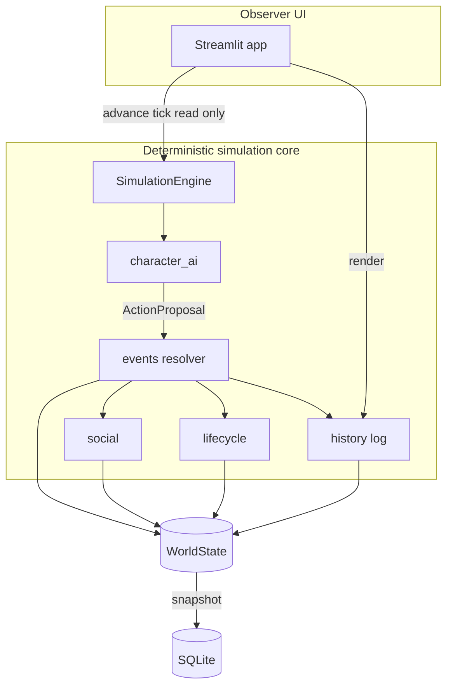
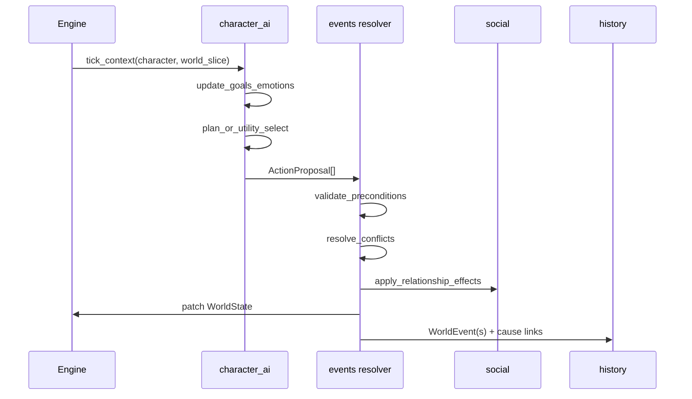

# KingGame — Simulation Architecture

**Status:** Target architecture (prototype branch implements Stage A subset)  
**Related:** [CURRENT_STATE_AUDIT.md](./CURRENT_STATE_AUDIT.md) · [ROADMAP.md](./ROADMAP.md) · [DECISIONS.md](./DECISIONS.md)

---

## 1. Architectural goals

1. **Deterministic core:** Same seed + same inputs ⇒ reproducible history (required for tests and debugging).
2. **Modular monolith:** Clear module boundaries in one Python process; no microservices.
3. **Simulation/UI separation:** `SimulationEngine` runs headless; Streamlit is a thin client.
4. **Single write path for facts:** All state changes go through resolvers that emit `WorldEvent`s.
5. **Chronicle as projection:** Narrative layer reads events; never writes world state.

**Preserve from prototype:** Pydantic models, seeded RNG, SQLite snapshots, package layout under `chronicle/`.

---

## 2. System boundaries

| Module | Responsibility | Owns |
|--------|----------------|------|
| `models` | Schema, invariants, pure helpers | Type definitions |
| `world` | IDs, constants | ID generation policy |
| `generation` | Initial realm construction | One-shot setup |
| `simulation/engine` | Tick orchestration, RNG scope | Day counter, tick order |
| `character_ai` | Goals, utility, plans, action choice | Goal/plan state on characters |
| `social` | Relationship deltas, memory formation, obligations | Relationship edges, memory lists |
| `events` (resolver) | Validate proposals, conflict resolution, apply effects | Transition logic |
| `simulation/lifecycle` | Demography hooks (birth/death/aging) | Vital statistics |
| `history` | Append events, causal index, chronicle text | Event log (derived indexes) |
| `persistence` | Save/load snapshots | External storage |
| `app` | Observer UI | Session state only |



---

## 3. Domain model (authoritative vs subjective)

### Authoritative (world truth)

- `Character` vital facts, parentage, house, titles held, alive, marriage IDs
- `House`, `Title` holders, succession law key
- `WorldEvent` log (immutable append)
- Legal states: `Marriage`, `Wardship`, `Oath` (future tables or embedded in world)

### Subjective (per-character)

- `Memory` records (may include `believed_summary` ≠ fact)
- `Belief` objects (optional Stage C5): propositions with confidence
- Reputation: **derived** from public events + rumour reach

### Derived (recomputable)

- Age, life stage, eligibility flags
- House head, heir presumptive
- Chronicle rankings, biography text

**Rule:** AI decisions use **beliefs** where applicable; resolver uses **truth** when applying physical/legal effects.

---

## 4. Character record (target shape)

Prototype `Character` already has hooks. Target extensions (by milestone):

| Field / object | Milestone |
|----------------|-----------|
| `emotions: dict[str, float]` | B2 |
| `goals: list[Goal]` populated | B1 |
| `active_plan: Plan \| None` | B3 |
| `memories: list[Memory]` populated | C2 |
| `wealth` or house share | defer (use house prestige) |
| `claims: list[ClaimId]` | D1 |
| `reputation_tags` | C5 |

Avoid unbounded trait sprawl: **6–8 independent temperament dimensions** (see [DECISIONS.md](./DECISIONS.md)).

---

## 5. Decision pipeline



### ActionProposal (target type)

```python
# Conceptual — implement in milestone B3
@dataclass
class ActionProposal:
    actor_id: str
    kind: str  # e.g. "propose_marriage"
    target_ids: list[str]
    parameters: dict
    utility: float
    plan_step_id: str | None
    motive_snapshot: dict  # for debugging/chronicle
```

### Utility selection

- Score actions: \( U(a) = \sum_i w_i \cdot s_i(a) + \text{personality_bias}(a) + \epsilon \)
- Select via **softmax** over top-K candidates (temperature from impulsiveness).
- Store `motive_snapshot` on resulting event effects.

---

## 6. Event model and causality

### Event lifecycle types

1. **Proposal** — intent (may fail validation)
2. **Attempt** — consumes opportunity; may fail
3. **Outcome** — state change
4. **Observation** — who learned what (Stage C5)

Prototype only implements **outcome** events.

### WorldEvent (target invariants)

- `id`: unique event id
- `causes`: list of **event ids** (not character ids)
- `effects`: structured patches + motive snapshots
- `visibility`: optional list of character ids (default: public court)

**Migration from prototype:** Replace character-id `causes` with event-id links in A3.

### Causal index (A3+)

Maintain `event_graph: parent -> children` in memory or SQLite side table for O(1) trace.

---

## 7. Simulation tick order (target)

Daily tick (configurable sub-steps):

1. Increment `day`; derive RNG from `seed + day`
2. **Emotion decay** (B2)
3. **Decision phase** — staggered: e.g. 1/7 of adult population per day for performance
4. **Resolver queue** — process all proposals in deterministic priority order (actor_id tie-break)
5. **Lifecycle** — deaths, births (existing), age yearly
6. **Housekeeping** — goal refresh, memory decay, obligation timers
7. **Chronicle projection refresh** (significance cache)

Current prototype: steps 5 subset only (deaths, marriages, births, yearly age).

---

## 8. Relationship system (target)

Storage: sparse directed map `RelationshipKey -> DirectedRelationship` plus explicit state objects:

- `MarriageRecord`, `Betrothal`, `Oath` with start day, parties, terms

Interaction rules in `social/`:

- Each action defines deltas per axis with caps and personality modulation
- Anti-drift: daily passive regression toward neutral unless reinforced

---

## 9. Persistence

**Prototype:** Single JSON blob of `WorldState` in SQLite.

**Future (F3):**

- Event log append-only file with snapshot checkpoints every N days
- Schema version field for migrations

No change required before Minimum Story Realm.

---

## 10. Technology constraints

| Allowed | Avoid (until proven need) |
|---------|---------------------------|
| Python 3.11+, Pydantic | Distributed sim, message queues |
| stdlib + pytest + hypothesis | LangChain / agent frameworks |
| Streamlit observer | LLM in resolver |
| SQLite | PostgreSQL |

Optional later: LLM **only** in `history/narrative_llm.py` for prose polish, reading event JSON, never writing state.

---

## 11. Headless and batch mode (F2)

```bash
python -m chronicle.run --seed 42 --days 10950 --export events.jsonl
```

Runs engine without Streamlit; feeds evaluation harness.

---

## Cross-references

- Pillar acceptance: [GAME_DESIGN.md](./GAME_DESIGN.md)
- Milestone mapping: [ROADMAP.md](./ROADMAP.md)
- Metrics: [SIMULATION_EVALUATION.md](./SIMULATION_EVALUATION.md)
